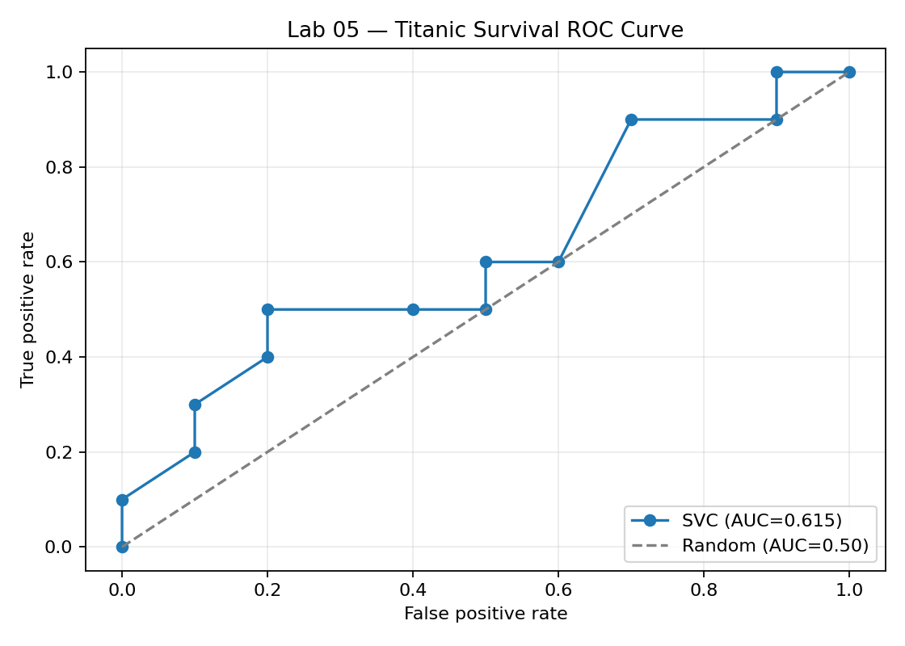

# Lab 05 — Titanic Passenger Survival Prediction System

**Course:** Introduction to Artificial Intelligence (AI–101L)  
**Dataset:** User-supplied `sample-data.csv` (100 rows, 5 columns)  
**Evaluation protocol:** Train/test = 80/20, stratified by survival, `random_state=42`; stratified 5-fold cross-validation (CV) on the 80 training rows.

## 1. Objectives

Formulate survival prediction as binary supervised classification, explore sample data, implement categorical imputation/encoding/scaling, train multiple estimators, evaluate accuracy and ROC/AUC, tune with GridSearchCV, and persist a model reusable for the next lab.

## 2. Exploratory data analysis (EDA)

The dataset includes `PClass`, `Gender`, `Sibling`, and `Embarked` as categorical predictors, and `Survived` as the binary target. It contains **no missing values**. There are **50 Yes** and **50 No** outcomes (balanced classes), so the **majority-class accuracy baseline is 50.0%**, not 62% as stated for a different Titanic distribution in the original notebook. The dataset lacks `Age`, `Fare`, `SibSp`, and `Parch`, limiting predictive context and genuine family-feature engineering. Category frequencies: PClass: Third 60, Second 20, First 20; Gender: Male 58, Female 42; Sibling: Zero 59, One 29, Two 6, Three 6; Embarked: Southampton 75, Cherbourg 16, Queenstown 9.

**Preprocessing:** a `ColumnTransformer` performs mode imputation, one-hot encoding and scaling within each sklearn `Pipeline`. The test set is never used to learn these transformations.

## 3. Three required classifiers

| Model | Test Accuracy |
|---|---|
| Logistic Regression | 50.0% |
| Decision Tree | 55.0% |
| Random Forest | 50.0% |

On the 20-person holdout, Decision Tree was highest among these three with 55.0%, but one person's prediction changes accuracy by 5 percentage points. This comparison is descriptive; tuned-model selection uses training CV rather than selecting by these holdout results.

## 4. Exercise 1 — FamilySize and IsAlone

Because `Parch` and `SibSp` are not available, true `FamilySize = SibSp + Parch + 1` and `IsAlone` **cannot be calculated**. We use clearly labeled **sibling-only proxies** in the exercise: `FamilySize = sibling_count + 1` and `IsAlone = (sibling_count == 0)`. This approximation can misclassify people traveling with parents/children/spouses; it is **not** a genuine reconstruction of Titanic family structure.

| Model | Test Accuracy Without | Test Accuracy With | Accuracy Delta |
|---|---|---|---|
| Logistic Regression | 50.0% | 50.0% | +0.0 pp |
| Decision Tree | 55.0% | 55.0% | +0.0 pp |
| Random Forest | 50.0% | 50.0% | +0.0 pp |

All test-set deltas were zero for these three models. This does not prove the features are generally useless; it only states the observed effect of these imperfect, redundant proxies in this tiny sample.

## 5. Exercises 3 and 4 — Five-fold CV and two extra models

Added `KNeighborsClassifier` and `SVC` to the model dictionary and reran the **same comparison function**; cross-validation was performed on the training split only.

| Model | Test Accuracy | CV Mean | CV Std |
|---|---|---|---|
| Logistic Regression | 50.0% | 68.8% | 15.3% |
| Decision Tree | 55.0% | 68.8% | 11.9% |
| Random Forest | 50.0% | 67.5% | 14.5% |
| KNeighborsClassifier | 60.0% | 65.0% | 9.4% |
| SVC | 55.0% | 67.5% | 14.5% |

CV standard deviations indicate substantial fold-to-fold variability. The CV means and holdout accuracies differ, particularly for LR/trees, indicating performance estimates are unstable at this sample size.

## 6. Hyperparameter tuning

Each model was tuned with `GridSearchCV(scoring='accuracy', cv=StratifiedKFold(5, shuffle=True, random_state=42))`; each candidate is a pipeline that fits preprocessing within each CV fold. The candidate is selected by **highest tuned training CV score** (model name breaks a tie).

| Model | Tuned CV Mean | Best Parameters |
|---|---|---|
| SVC | 75.0% | `C=0.1, kernel=linear` |
| Logistic Regression | 72.5% | `C=0.1` |
| Decision Tree | 71.2% | `max_depth=2, min_samples_leaf=1` |
| Random Forest | 71.2% | `max_depth=3, min_samples_leaf=1, n_estimators=50` |
| KNeighborsClassifier | 67.5% | `n_neighbors=5, weights=distance` |

**Selected:** SVC, parameters `{'model__C': 0.1, 'model__kernel': 'linear'}`. Best five-fold CV accuracy: **75.0%**. The deployed lab artifact uses this fitted estimator *with its preprocessing*, not a model trained on manually encoded inputs.

## 7. Exercise 2 — Held-out evaluation and ROC

- **Final test accuracy:** 65.0% (13/20 observations correct)
- **ROC AUC:** 0.615
- **Confusion matrix:** rows actual (No, Yes); columns predicted (No, Yes): `[[8, 2], [5, 5]]`
- **Survival recall (Yes):** 0.50 (5 of 10 actual survivors detected)
- **Example passenger:** First class, Female, Zero siblings, Southampton → **Yes** (example prediction, not a factual outcome).



```
              precision    recall  f1-score   support

          No       0.62      0.80      0.70        10
         Yes       0.71      0.50      0.59        10

    accuracy                           0.65        20
   macro avg       0.66      0.65      0.64        20
weighted avg       0.66      0.65      0.64        20
```

**Interpretation:** ROC AUC ≈ 0.615 is only modestly better than random ranking (0.5); therefore the candidate should **not** be described as accurate or production-ready.

## 8. Home assignment — Manual CV vs fully fold-safe pipeline

The manual approach fits the preprocessor once on **all 80 training rows** and then performs CV on that processed matrix. It leaks fold-validation information (category frequencies/scaling statistics) into fold training. In contrast, the pipeline performs imputation, one-hot encoding, scaling and classifier fitting inside every CV fold.

| Evaluation | Mean CV accuracy |
|---|---:|
| Manual preprocessing before five-fold CV | 75.0% |
| Entire preprocessing inside a Pipeline (five-fold CV) | 75.0% |
| Pipeline minus manual | +0.0 percentage points |

**Why no observed difference?** The sample has no missing features, and its categorical levels appear across folds. The manual flow still has a **methodological leakage risk** even though it happens not to change the scores here. Differences depend on the dataset, preprocessing and split; leakage does not always inflate measured accuracy. The separate holdout test set remains untouched by either CV procedure.

## 9. Model persistence and lab-06 recommendation

`joblib.dump` saved the **entire tuned pipeline** as `titanic_best_model.joblib`. It can predict from raw categorical DataFrames with exactly the four named input columns. Also saved: fitted legacy label encoders (`pclass_encoder.pkl`, `gender_encoder.pkl`, `sibling_encoder.pkl`, `embarked_encoder.pkl`, `survived_encoder.pkl`). **Do not** apply those feature label encoders to input before calling the full pipeline; the pipeline already performs one-hot encoding. The target encoder may be used to convert `0/1` outputs into `No/Yes`.

**Deployment decision:** Use the tuned SVC **only as the Lab 06 classroom prototype**, because it had the best tuned training CV score under the stated protocol. Do not claim real-world reliability from a 100-row sample or 20-row holdout. Before practical deployment, obtain a larger representative dataset, add real family fields and other features, and repeat cross-validation, independent holdout checks and appropriate monitoring.

## 10. Feedback and improvement phases

For any prototype deployment, capture authorized feedback about wrong predictions, log model versions, avoid unnecessary personal data collection, audit dataset bias, and retrain using higher-quality, more representative records. Titanic survival prediction is a historic teaching example, not a safety decision system.
